# Architecture and robustness proof

## Part 1 — Diagram

Final diagram (Phase 8). Source: [diagrams/architecture.mmd](diagrams/architecture.mmd); the same source is below so GitHub draws it. It shows every component with its file and function, the byte layout with sizes, the numbered write order, the recovery flow (including a half-done compaction or snapshot), the compaction flow and both locks. Rendering was **not checked on our laptop** (no Mermaid tool installed, and we work offline); no exported image exists.

```mermaid
%% Architecture of the crash-safe key-value store — FINAL (Phase 8). Mermaid source.
%% Every box names the file and function that implements it.
flowchart TD

  subgraph CLIENTS["Clients"]
    CLI["kvdb.py commands: open put get del batch dump check compact"]
    SERVE["kvdb.py serve: 1 reader thread + 4 workers, stdout lines under a lock, flushed"]
  end

  subgraph ENGINE["Engine: src/kv"]
    OPEN["open_db (db.py): 1. flock on path.lock, 2. recovery.recover"]
    FLOCK{{"File lock: fcntl.flock on path.lock, one open at a time, freed when the process dies"}}
    GLOCK{{"Global lock: threading.Lock, held by put/delete/batch, get, compact, close"}}
    GUARD["Size cap guard (DB._commit): end + size over max_bytes? then E5: compact WITH the write, else SizeCapReached"]
    WP["One write path: DB._commit, used by put, delete, batch"]
    LAYOUT["layout.py: encode_body, encode_commit, decode_txn"]
    IDX[("In-memory index: dict key to offset shl 21 or length")]
    REC["recovery.py: recover, scan (fast path + decode_txn); check is read-only"]
    SNAP["snapshot.py: index snapshot path.idx (a cache)"]
    COMP["DB.compact / _compact_locked: section 11"]
    PAUSE["pause.py: KVDB_PAUSE_AT pause points"]
  end

  subgraph FILES["Files next to the database"]
    DATA[("path: the log")]
    IDXF[("path.idx: snapshot")]
    LOCKF[("path.lock: empty")]
    TMPS[("path.compact.tmp / path.idx.tmp: temporary, deleted at open")]
  end

  CLI --> OPEN
  SERVE --> OPEN
  OPEN --> FLOCK --> LOCKF
  OPEN --> REC
  SERVE --> GLOCK
  CLI --> GLOCK
  GLOCK --> GUARD --> WP --> LAYOUT
  WP -- "write handle r+b, unbuffered" --> DATA
  WP -- "after commit, every max(10000, keys/8) txns" --> SNAP --> IDXF
  GLOCK -- "get: read handle rb, unbuffered" --> IDX
  REC -- "load if it matches the log" --> IDXF
  REC -- "scan from E_c or 16" --> DATA
  REC -- rebuilds --> IDX
  GLOCK --> COMP --> TMPS
  COMP -- "os.replace" --> DATA
  PAUSE -.-> WP
  PAUSE -.-> REC
  PAUSE -.-> COMP
  PAUSE -.-> SNAP

  subgraph LAYOUTBOX["On-disk layout, little-endian, sizes in bytes"]
    L0["File header 16: magic KVDB 4, version 2 = 1, flags 2 = 0, max_bytes 8"]
    L1["Transaction header 3: type 1 = 0xA1, op_count 2 = 1 to 10000"]
    L2["Each op 7 + key + value: op 1 (1 put, 2 del), key_len 2 = 1 to 1024, val_len 4 = 0 to 1048576, key, value"]
    L3["Commit marker 16: magic CMIT 4, body_len 8, crc32 4 of header + ops"]
    L4["Trailer 1 = 0xEE"]
    L0 --> L1 --> L2 --> L3 --> L4
    L4 -- "next transaction" --> L1
  end

  subgraph WRITE["Write order, DB._commit (CLAUDE.md section 9)"]
    W0["take the global lock"]
    W1["1 validate everything incl. the cap, error = file untouched"]
    W2["2 remember end offset E"]
    W3["3 seek E, write body (loop)"]
    W4["4 os.fsync: body on disk"]
    W5["5 write commit marker + trailer"]
    W6["6 os.fsync: COMMITTED"]
    W7["7 apply to the dict in list order"]
    W8["8 release lock, return: serve prints ACK"]
    WX["error in 3 to 6: truncate to E, os.fsync, raise; that fails too: database failed"]
    W0 --> W1 --> W2 --> W3 --> W4 --> W5 --> W6 --> W7 --> W8
    W3 -.-> WX
    W6 -.-> WX
  end

  subgraph RECOVERY["Recovery flow, recovery.recover (section 10)"]
    R0["open file"]
    R1{"exists?"}
    R1N["create header, fsync file + folder"]
    R2{"16 bytes or more?"}
    R2S{"prefix of our header?"}
    R2F["fresh header, fsync"]
    R3{"magic, version, flags OK?"}
    RNO["refuse: NotOurFile, untouched"]
    RT0["delete path.compact.tmp and path.idx.tmp: half-done compaction or snapshot"]
    RS{"path.idx valid for this log?"}
    RSY["index = snapshot, scan from E_c"]
    RSN["index empty, scan from 16"]
    R5{"how did the scan end?"}
    RT["TORN: ftruncate to absolute offset, fsync"]
    RM["TRAILER MISSING: write 0xEE, fsync"]
    RC["CORRUPT: refuse, untouched"]
    RR["ready: keys, ms, bytes cut, trailer restored, snapshot"]
    R0 --> R1
    R1 -- no --> R1N --> RR
    R1 -- yes --> R2
    R2 -- no --> R2S
    R2S -- yes --> R2F --> RR
    R2S -- no --> RNO
    R2 -- yes --> R3
    R3 -- no --> RNO
    R3 -- yes --> RT0 --> RS
    RS -- yes --> RSY --> R5
    RS -- no --> RSN --> R5
    R5 -- clean --> RR
    R5 -- "torn tail" --> RT --> RR
    R5 -- "ends at a marker" --> RM --> RR
    R5 -- "bad byte" --> RC
  end

  subgraph COMPACTION["Compaction flow, DB._compact_locked (section 11), global lock held"]
    C1["1 delete leftover path.compact.tmp"]
    C2["2 write live keys to path.compact.tmp as batches, same max_bytes"]
    C3["3 os.fsync, close"]
    C4["4 validate: full read-back scan, else delete temp + CompactionFailed"]
    C5["5 delete old path.idx"]
    C6["6 close BOTH handles"]
    C7["7 os.replace temp onto path: the only switch"]
    C8["8 os.fsync the folder"]
    C9["9 reopen handles, index from step 4"]
    C10["10 write a fresh snapshot, release lock"]
    C1 --> C2 --> C3 --> C4 --> C5 --> C6 --> C7 --> C8 --> C9 --> C10
  end
```

## Part 2 — Scenario-to-mechanism proof table

The "Scenario" and "Expected after restart" columns are copied from the official brief, Section 5. The text was taken from the PDF; only line breaks and letter-spacing artefacts of the PDF text extraction were removed.

Status after Phase 8: "Disk state" refers to the format in README "On-disk format" (E = the end offset remembered before a transaction). Every row was checked against the code in Phase 8; six rows were audited word by word (`docs/self-audit.md`). "Where in the code" is a **real** file and function for rows with a passing test (Phase 3); other rows still say "planned". "Verified by" names only tests that exist and passed. "Targeted kill" = a hard kill (SIGKILL) at a named pause point, reported separately from random torture runs, which do not exist yet.

| ID | Scenario (brief §5) | Expected after restart (brief §5) | Disk state at the moment of the kill | Mechanism that handles it | Where in the code | Verified by |
|---|---|---|---|---|---|---|
| A1 | Kill before any bytes of a put reach the file | Key absent (or holds its previous value) | File ends at E (the last trailer EE, or the 16-byte header for an empty database); no byte of the new transaction | Nothing to repair. Step 1 validates before any write; the index holds only committed transactions | src/kv/db.py DB._commit; src/kv/recovery.py recover, scan; src/kv/layout.py decode_txn | Targeted kill: tests/test_crash.py WriteKillTest.test_put [write.before-body]: old value |
| A2 | Kill after some bytes of the record are written but not all (torn write) | Key absent or previous value. The torn bytes are ignored, never returned as a value | Last trailer, then a prefix of the new transaction (header and/or part of an op) | TORN: a field needs more bytes than remain, so recovery truncates to that absolute offset and fsyncs. Staged ops never reach the dict | src/kv/db.py DB._commit; src/kv/recovery.py recover, scan; src/kv/layout.py decode_txn | Targeted kill: tests/test_crash.py WriteKillTest.test_put [write.mid-body]: old value. Cuts: tests/test_db.py FiveCutTest.test_five_cuts (header, key, value) |
| A3 | Kill after the record is fully written but before fsync | Either outcome is acceptable, because success was not returned. Must not corrupt anything else | Complete body (transaction header + ops); commit marker absent, or written but second fsync not done | No complete marker: TORN, truncate, previous value. Complete marker: committed, new value. Both allowed | src/kv/db.py DB._commit; src/kv/recovery.py recover, scan; src/kv/layout.py decode_txn | Targeted kill: tests/test_crash.py WriteKillTest.test_put [write.after-body, write.after-body-sync: old; write.after-marker: new] |
| A4 | Kill after fsync returns but before put returns success to the caller | Key present with the new value. The data was durable, even though the caller never heard back | Body, marker and trailer complete; both fsyncs returned | Marker complete and body_len and crc32 match, so recovery applies the transaction | src/kv/db.py DB._commit (step 6, then step 7); src/kv/recovery.py recover, scan; src/kv/layout.py decode_txn | Targeted kill: tests/test_crash.py WriteKillTest.test_put [write.after-commit-sync]: new value; through serve: tests/test_cli.py ServeTest.test_pause_point_in_serve_then_kill (no ACK sent, value present) |
| A5 | Kill immediately after put returns success | Key present with the new value. No exceptions | As A4, and ACK was sent | As A4. serve sends ACK only after DB._commit returns: after step 6, or — for a write that did not fit under max_bytes (E5) — after the compaction's os.replace, which is then its commit point | src/kv/db.py DB._commit, _commit_by_compaction; kvdb.py Server.run_request; src/kv/recovery.py recover, scan | Targeted kill: tests/test_crash.py WriteKillTest.test_put_killed_after_it_returned; test_put [write.after-index]; through serve: tests/test_cli.py ServeTest.test_ack_then_sigkill_by_pid_then_reopen (ACK, kill -9 PID, get = 20) |
| A6 | Kill during a delete | Key either still present with old value, or absent. Never a corrupted value | As A1-A5 for a transaction with op = 2, val_len = 0 | Same single write path as put. The delete removes the key only after a valid marker | src/kv/db.py DB._commit via DB.delete; src/kv/recovery.py recover, scan; src/kv/layout.py decode_txn | Targeted kill: tests/test_crash.py WriteKillTest.test_delete, all 7 write pause points |
| A7 | Kill during a put of a 1 MB value | Same rules as A1 to A5, with a large value spanning many disk blocks | As A1-A5; the 1,048,576-byte value spans many blocks, a mid-value kill leaves val_len larger than the bytes left | val_len is checked against the limit and the bytes left before reading: TORN, truncate. The write loop handles short writes | src/kv/db.py DB._commit (DB._write_all loop); src/kv/recovery.py recover, scan; src/kv/layout.py decode_txn | Targeted kill: tests/test_crash.py WriteKillTest.test_one_megabyte_value [mid-body, after-body: old; after-marker, after-commit-sync: new]; tests/test_layout.py CutTest.test_every_cut_of_a_large_value; random: torture --mode large-values seed 999111 PASS 10/10 (evidence/torture/run-large-values-10-seed-999111.txt) |
| B1 | Kill after 3 of 10 operations in a batch are written | None of the 10 are visible | Transaction header with op_count 10, 3 complete ops, maybe part of a 4th; no marker | Ops are staged and applied only after a valid marker. File ends: TORN, truncate | src/kv/db.py DB._commit via DB.batch; src/kv/recovery.py recover, scan; src/kv/layout.py decode_txn | tests/test_db.py BatchCutTest.test_ten_op_batch: a 10-op batch cut at every byte, including right after op 3 — none visible; targeted kill: tests/test_crash.py WriteKillTest.test_batch_of_ten [write.mid-body], which lands after 4 whole ops and the 5th op's header and key — none visible |
| B2 | Kill after all 10 are written but the commit marker is not | None of the 10 are visible | Transaction header and all 10 ops; marker absent or incomplete | As B1: no complete marker, nothing applied, truncate | src/kv/db.py DB._commit; src/kv/recovery.py recover, scan; src/kv/layout.py decode_txn | tests/test_crash.py WriteKillTest.test_batch_of_ten [write.after-body, write.after-body-sync]; BatchCutTest.test_ten_op_batch (cuts inside the marker) |
| B3 | Kill after the commit marker is written but before fsync | Either all or none. Never some | Body fsynced; marker and trailer written, second fsync not done. After a process kill the bytes are still in the OS page cache; a short write may leave part of the marker | Complete matching marker: all 10 applied. Incomplete: TORN, none. A transaction is only ever applied whole | src/kv/db.py DB._commit; src/kv/recovery.py recover, scan; src/kv/layout.py decode_txn | tests/test_crash.py WriteKillTest.test_batch_of_ten [write.after-marker]: all 10 |
| B4 | Kill after the batch returns success | All 10 visible | Body, marker and trailer complete and fsynced | Valid marker, all 10 applied | src/kv/db.py DB._commit; src/kv/recovery.py recover, scan; src/kv/layout.py decode_txn | tests/test_crash.py WriteKillTest.test_batch_of_ten [write.after-commit-sync, write.after-index]: all 10 |
| B5 | A batch that puts key X and deletes key X in the same batch | Define the ordering in your README and honour it after a crash | One transaction: op put X, then op del X | Ops apply in list order in the write path and in recovery alike; the last op on a key wins, so X is absent. Stated in README | src/kv/db.py DB._apply; src/kv/recovery.py scan (list order) | tests/test_db.py SemanticsTest.test_put_then_delete_in_one_batch (with reopen) |
| B6 | A batch of 10,000 operations, killed halfway | None visible. Recovery still completes in under 2 seconds | Transaction header with op_count 10,000, about 5,000 ops, no marker | TORN, truncate. Op lengths are walked without reading values. Recovery under 2 s NOT measured | src/kv/db.py DB._commit; src/kv/recovery.py recover, scan; src/kv/layout.py decode_txn | None visible: tests/test_crash.py WriteKillTest.test_batch_of_ten_thousand_killed_halfway [write.mid-body] passed. Under 2 s: 1.073 s on 1,000,000 keys with the snapshot (torture --mode scale seed 6003, evidence/recovery-benchmark-keys8.txt); random: torture --mode large-batches seed 424299, 23 batches of 1,000-10,000 ops in flight at a kill, all all-or-nothing (evidence/torture/in-flight-analysis.txt) |
| C1 | Kill during open() while it is replaying the log | The next open() succeeds and reaches the same correct state | Unchanged: the scan only reads | Recovery writes nothing before the cut or trailer step, so the next open repeats the same scan | src/kv/recovery.py recover, scan; src/kv/layout.py decode_txn | Targeted kill: tests/test_crash.py OpenKillTest.test_kill_during_recovery_twice [recovery.replay]; random: torture --mode recovery-crash seed 4201 PASS 100/100, 216 kills landed during recovery (evidence/torture/run-recovery-crash-100-seed-4201.txt) |
| C2 | Kill during open() while it is truncating or repairing a torn tail | The next open() succeeds | File still long or already truncated to p; trailer missing or already restored | ftruncate to an absolute offset p is safe to repeat; a missing trailer is detected again and rewritten | src/kv/recovery.py recover (steps 6, 7) | Targeted kill: OpenKillTest.test_kill_during_recovery_twice [recovery.before-cut, recovery.after-cut]; OpenKillTest.test_kill_before_trailer_restore; random: same recovery-crash run (kills during recovery after torn tails) |
| C3 | Kill during compaction, before the new file replaces the old | Old file is still authoritative, all data intact | Original file complete; <path>.compact.tmp partial (compact.mid-write) or complete and validated (compact.before-swap); old snapshot already deleted at before-swap | Compaction writes a separate temporary file and only os.replace makes it the database; open deletes a leftover temporary file and opens the original | src/kv/db.py DB.compact, _compact_locked (CLAUDE.md section 11); src/kv/recovery.py recover (deletes <path>.compact.tmp) | Targeted kill: tests/test_compact.py CompactKillTest.test_kill_at_every_compaction_pause_point [compact.mid-write, compact.before-swap]: original bytes unchanged, all data intact; test_stale_complete_temp_file_is_never_trusted; torture --mode targeted seed 3131 (compact.* PASS); random: torture --mode compaction seed 7701 PASS 100/100, 80 kills during a compaction |
| C4 | Kill during compaction, in the middle of the rename or swap | Exactly one of old or new is authoritative, both are complete, nothing is lost | os.replace (rename) on APFS: the path names either the complete original or the complete compacted file | The temporary file is fsynced, closed and validated by a full read-back scan before os.replace; both handles are closed first; the folder is fsynced after | src/kv/db.py DB.compact, _compact_locked (CLAUDE.md section 11); src/kv/recovery.py recover (deletes <path>.compact.tmp) | Targeted kills on both sides of the swap: CompactKillTest [compact.before-swap, compact.after-swap]; random: torture --mode compaction seed 7701 PASS 100/100. A kill INSIDE the rename itself cannot be targeted from Python: not verified separately |
| C5 | Kill during compaction, after swap but before cleanup of temporary files | Data intact. Leftover temp files are cleaned up or ignored on the next open() | <path> is the new compacted file; no temporary file; no snapshot (deleted in step 5) | Nothing left to clean except the snapshot, which cleanup rewrites; open deletes any <path>.compact.tmp or <path>.idx.tmp | src/kv/db.py DB.compact, _compact_locked (CLAUDE.md section 11); src/kv/recovery.py recover (deletes <path>.compact.tmp) | Targeted kill: CompactKillTest [compact.after-swap, compact.before-cleanup]: compacted file in place, no .idx, all data intact, writes and reopen work |
| C6 | Kill during close() | Same as a kill at any other time. close() is not special | Every committed transaction was already fsynced; close writes nothing | close only closes the handles under the lock. No shutdown record, so a kill in close is like any other kill | src/kv/db.py DB.close | Targeted kill: tests/test_crash.py OpenKillTest.test_kill_during_close [close]: file bytes unchanged |
| D1 | Two writers putting different keys, killed at random | Every acknowledged put from either writer is present | Transactions of both writers back to back, never interleaved; at most the last one torn | One global lock serialises whole transactions; ACK only after step 6 | src/kv/db.py DB._commit (one global lock); kvdb.py Server | torture default mode, 3 writer threads with separate keys: seed 1717 PASS 200/200 on the current (Phase 7) code; earlier seeds 60606 and 777001 on the Phase 5 code (evidence/torture/) |
| D2 | Two writers putting the same key, killed at random | The key holds a value that one of the writers actually wrote. Never a mix of two values | Transactions of both writers on the same keys, serialised by the global lock; at most one torn at the end | One global lock: each request is applied whole; the final value of a key is one writer's whole value | src/kv/db.py DB._commit (one global lock) | torture --mode overlap seed 5501 PASS 100/100: 3 writers on 8 shared keys, final value checked against send/ACK order (evidence/torture/run-overlap-100-seed-5501.txt) |
| D3 | One writer in a long batch, another doing single puts, killed at random | Batch is all-or-nothing. Single puts that were acknowledged are present | The batch is one transaction; single puts are separate transactions before or after it, never inside | The global lock is held for the whole batch; all-or-nothing through its marker | src/kv/db.py DB._commit; src/kv/recovery.py scan | torture --mode large-batches seed 424299 PASS 10/10: batches of up to 9,867 ops in flight next to single puts from other writers (evidence/torture/in-flight-analysis.txt) |
| D4 | A reader calling get during a batch on the same keys (no crash) | Reader sees the state before the batch or after it. Never in between | No crash | get takes the same global lock as the batch, so it runs wholly before or wholly after the batch and its dict update | src/kv/db.py DB.get, DB._commit (one global lock) | tests/test_db.py ThreadTest.test_reader_never_sees_inside_a_batch (no crash; 300 batches, 3 reader threads) |
| E1 | File size cap reached during a single put | put returns an error. Database still readable. Previous data intact | Unchanged: nothing written (the write does not fit even compacted) | DB._commit step 1: end + size > max_bytes -> DB._commit_by_compaction computes the compacted size WITH the write; too big -> SizeCapReached before any byte is written | src/kv/db.py DB._commit, _commit_by_compaction | tests/test_compact.py CapTest.test_e1_single_put_over_the_cap; tests/test_db.py CapTest; torture --mode disk-full seed 9901 PASS 100/100 with 449 clean SizeCapReached refusals |
| E2 | Cap reached halfway through a batch | Batch returns an error. None of its operations are visible | Unchanged: the whole batch is sized (and its compacted size computed) before writing | Same as E1 for the whole batch: all or nothing | src/kv/db.py DB._commit, _commit_by_compaction | tests/test_compact.py CapTest.test_e2_batch_over_the_cap; tests/test_db.py CapTest |
| E3 | Cap reached, then process killed | Restart succeeds. All previously acknowledged data intact | An ordinary committed file at or under the cap | Refused writes change nothing, so recovery is normal | src/kv/db.py DB._commit; src/kv/recovery.py recover | Hard kill: tests/test_compact.py CapTest.test_e3_cap_reached_then_killed; random: torture --mode disk-full seed 9901 PASS 100/100, file never over the cap |
| E4 | Cap reached during compaction | Compaction fails or completes. Either way, no data lost and database still opens | Original untouched; temporary file partial or complete | The temporary file is not counted against the cap (team decision); a compacted file over max_bytes or a write error (real disk full) aborts before the swap with CompactionFailed, temporary file deleted | src/kv/db.py DB.compact, _compact_locked (CLAUDE.md section 11); src/kv/recovery.py recover (deletes <path>.compact.tmp) | tests/test_compact.py CapTest.test_e4_compaction_at_the_cap (completes, cap kept); CompactFailureTest.test_disk_full_during_write_leaves_the_original_working (injected ENOSPC) |
| E5 | After deletes free up space, compaction runs, writes succeed again | Database is usable again without manual intervention | A file at the cap; after the write either the old file (write absent) or the compacted file with the write (write present) | E5: a write that does not fit runs compaction WITH that write applied; os.replace is its commit point; if even that does not fit, SizeCapReached | src/kv/db.py DB._commit_by_compaction, _compact_locked | tests/test_compact.py CapTest.test_e5_deletes_free_space_and_writes_succeed_again; torture --mode disk-full seed 9901 (writes keep succeeding after refusals) |
| F1 | 500 consecutive random kills and restarts | Invariant holds after every single one | Any state from groups A to E | All mechanisms above; shown only by the torture tool | src/kv/db.py DB._commit; src/kv/recovery.py recover, scan | Partly: 200 consecutive random kills PASS 200/200 four times — seeds 777001 (Phase 5 code), 909090, 313131 (Phase 6) and 1717 (Phase 7 code, 152.2 s) (evidence/torture/). 500 in one run: not run yet |
| F2 | Kill, restart, kill during recovery, restart, kill during recovery again | Invariant holds. Recovery is idempotent | As C1 and C2 | Recovery is idempotent: read-only scan, absolute-offset truncate, trailer restore re-detected | src/kv/recovery.py recover, scan; src/kv/layout.py decode_txn | Targeted: tests/test_crash.py OpenKillTest.test_kill_during_recovery_twice (kill during recovery, restart, kill during recovery again); random: torture --mode recovery-crash seed 4201 PASS 100/100 — 3 restarted serves killed per iteration, 216 of the 300 kills landed during recovery (evidence/torture/run-recovery-crash-100-seed-4201.txt) |
| F3 | 1,000,000 keys written, process killed, open() called | Recovery completes in under 2 seconds, all acknowledged keys present | 16-byte header, 1,000,000 committed transactions, maybe a torn tail | Index snapshot <path>.idx (CLAUDE.md section 8a) loaded with C-level calls, then only the log after it replayed by the fast path in scan | src/kv/snapshot.py load, write; src/kv/db.py DB._snapshot; src/kv/recovery.py recover, scan | torture --mode scale seed 6003: 1,000,000 keys built through serve, hard kill, slowest of 5 opens 1.253 s, all keys correct; worst case (snapshot 125,000 transactions old) 1.127 s (evidence/recovery-benchmark-keys8.txt, evidence/recovery-benchmark.md) |
| F4 | Database file truncated by 1 byte at the end by hand (simulates a lost tail) | open() succeeds. At most the last unacknowledged record is lost | All transactions complete; only the last trailer EE missing (or an empty database cut to 15 bytes) | File ends right after a valid marker: the transaction is valid; write EE back and fsync before any new write. A 15-byte header prefix gets a fresh header | src/kv/recovery.py recover (step 7); src/kv/layout.py decode_txn (NO_TRAILER) | tests/test_db.py FiveCutTest.test_five_cuts ['trailer only']; tests/test_crash.py OpenKillTest.test_kill_before_trailer_restore |

## Part 3 — The three guarantees

All three are claimed for **process death** (a hard kill), which is what the brief tests — not for power loss (BREAKING.md weakness 1).

### Durability: once ACK is sent, the data survives

`serve` sends `ACK <id>` only after `DB._commit` has returned (`kvdb.py` `Server.run_request`). Normally `_commit` returns only after this sequence on the data file: `write()` of the body in a loop until every byte is out, `os.fsync`, `write()` of the 16-byte commit marker and the trailer, `os.fsync` (`src/kv/db.py` `DB._commit`, steps 3–6). Every one of those `write()` calls has finished, so the bytes are in the operating system's page cache, which a killed process does not take with it; the next `open` reads them, finds a complete marker whose body_len and `zlib.crc32` match the body, and applies the transaction (`src/kv/recovery.py` `scan`). Nothing that open does can remove a committed transaction: it only cuts bytes that come after the last complete one (`os.ftruncate` to the start of the torn transaction) and refuses files with impossible bytes instead of truncating them. A write that does not fit under `max_bytes` (E5) returns instead after a compaction that includes it: the compacted file is `os.fsync`ed, read back and checked, and the `os.replace` that makes it the database is that write's commit point, followed by an `os.fsync` of the folder (`DB._commit_by_compaction`, `DB._compact_locked`). Every compaction keeps every ACKed value because the new file must pass that full read-back check before `os.replace`. Verified by `tests/test_crash.py` (a kill at `write.after-commit-sync` keeps the value, A4) and `torture` (`evidence/torture/`, e.g. 200/200 with seed 1717).

### Atomicity: a batch is never half visible

A batch is ONE transaction: one header with its op count, all its operations, then one commit marker whose crc32 covers the header and every operation (`src/kv/layout.py`). The marker is written only after the whole body has been written and `os.fsync`ed (`DB._commit` steps 3–5). Recovery stages a transaction's operations and adds them to the index only after the marker is complete and matches (`recovery.scan` fast path and `layout.decode_txn`): a transaction cut anywhere — inside an op, before the marker, inside the marker — contributes nothing, and its bytes are cut with `os.ftruncate`. In a running database the index is changed only after step 6, under the global lock that `get` also takes, so a reader sees the state before or after a batch, never in between. Verified by `tests/test_db.py` `BatchCutTest` (a batch cut at every byte: none or all), `tests/test_crash.py` (kills at every write pause point during a 10-op and a 10,000-op batch), `tests/test_db.py` `ThreadTest.test_reader_never_sees_inside_a_batch` and `torture --mode large-batches` (`evidence/torture/in-flight-analysis.txt`: 23 batches of 1,000+ ops in flight at a kill, none partly present).

### Recoverability: open always succeeds on a file our database produced

A kill can only shorten what is being written, and recovery has a defined action for every shortened state: a missing file gets a header (`os.open` with `O_CREAT|O_EXCL`, `write`, `os.fsync` of the file and the folder); a file shorter than 16 bytes that is a prefix of our header gets a fresh header; a torn tail is cut with `os.ftruncate` to an ABSOLUTE offset and `os.fsync`; a missing final trailer is written back and `os.fsync`ed (`recovery.recover` steps 1–7). Each repair gives the same result if it is interrupted and run again (C1, C2, F2). A half-done compaction or snapshot leaves only a temporary file, which open deletes, because the switch to a new file is a single `os.replace` done after the new file was `os.fsync`ed and validated, and the original is never deleted first (`DB._compact_locked`, `snapshot.write`). Opening is protected by `fcntl.flock` on `<path>.lock`, taken before recovery, so a second process cannot cut a write in progress (`src/kv/db.py` `open_db`). Verified by `tests/test_crash.py` `OpenKillTest`, `tests/test_compact.py` `CompactKillTest`, `tests/test_snapshot.py`, `tests/test_lock.py` and `torture --mode recovery-crash` (100/100, 216 kills during recovery) and `--mode compaction` (100/100, 80 kills during a compaction).
