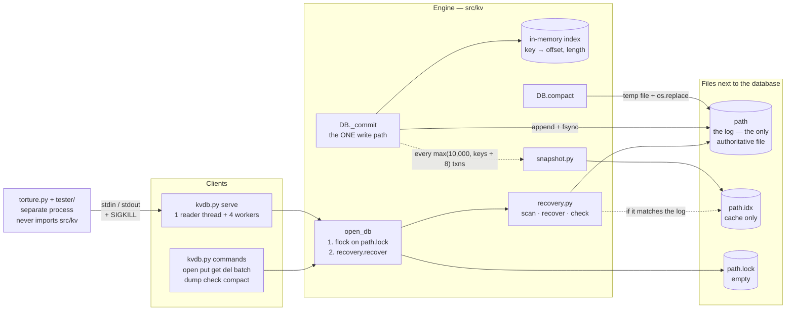
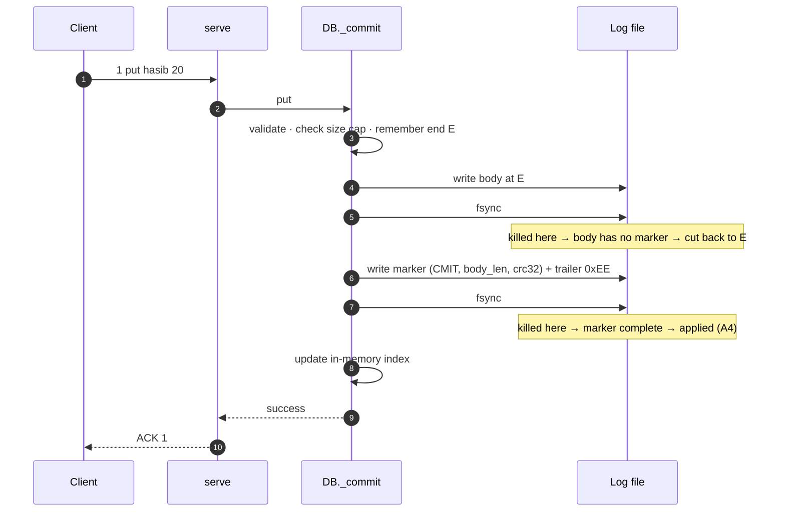
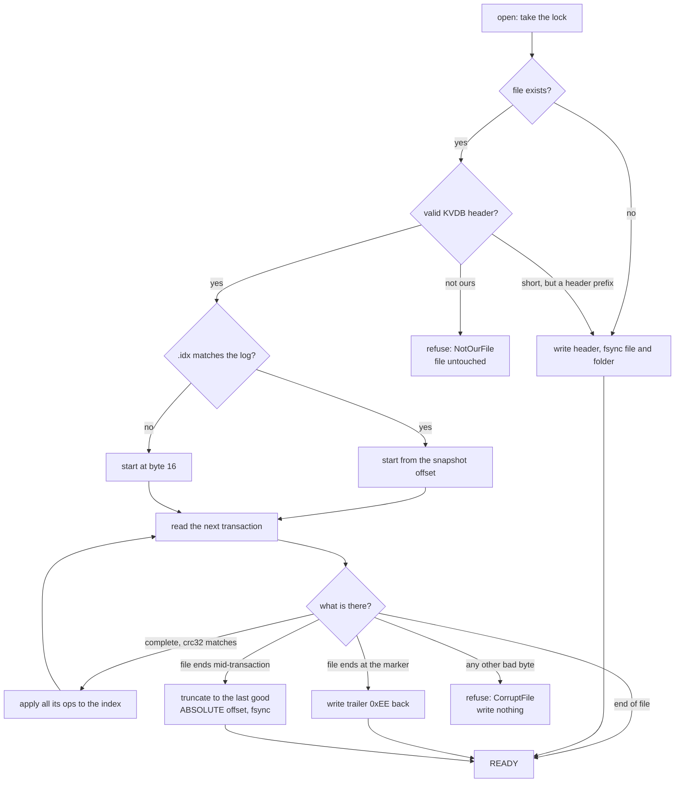
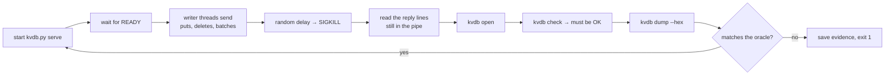

<div align="center">

# Kill It and Prove It

### A crash-safe key-value store in pure Python — and the tool that tries to break it

**Kill it at any moment. Open it again. Every acknowledged write is still there.**

`Python 3.10+` · `standard library only` · `119 unit tests pass` · `torture 200/200` · `1M keys recover in 1.253 s` · `tested on macOS 15.8.1`

</div>

---

## What this is

This repository holds two programs.

1. **`kvdb`** — a key-value database. It keeps all its data in **one append-only log file**. It survives a hard kill (`kill -9`) at any instruction, including in the middle of recovery and in the middle of compaction.
2. **`torture`** — a test tool that starts the database, kills it at random moments, reopens it, and checks every promise. It talks to the database **only as a separate process**. It never imports the engine.

Everything is written in Python with the **standard library only**. There are no databases, no storage libraries, and nothing to install.

> **What we claim:** safety against **process death** (a hard kill).
> **What we do not claim:** safety against power loss or an operating-system crash. See [Known limits](#known-limits).

---

## At a glance

All numbers below are real measurements. Each links to its raw output.

| What | Result | Evidence |
|---|---|---|
| Unit tests | **119 tests, all pass** (29.3 s) | [`evidence/final/unit-tests.txt`](evidence/final/unit-tests.txt) |
| Judge's command, `./torture --iterations 200`, Wi-Fi off | **PASS 200/200** in 169.4 s | [`evidence/final/offline-clean-clone.txt`](evidence/final/offline-clean-clone.txt) |
| Same command, clean clone from GitHub | **PASS 200/200** in 181.05 s | [`evidence/final/torture-i200-s880022.txt`](evidence/final/torture-i200-s880022.txt) |
| Longest random run | **PASS 500/500** | [`evidence/final/torture-i500-s880011.txt`](evidence/final/torture-i500-s880011.txt) |
| Kills with a request in flight | **100 %** in every final run | [`evidence/final-runs.md`](evidence/final-runs.md) |
| Kills that landed **during a compaction** | **88 of 100** — all passed | [`torture-i100-s880044-compaction.txt`](evidence/final/torture-i100-s880044-compaction.txt) |
| Kills that landed **during recovery** | **233** extra kills — all passed | [`torture-i100-s880055-recovery-crash.txt`](evidence/final/torture-i100-s880055-recovery-crash.txt) |
| Every pause point, hard-killed on purpose | **51/51** (17 points × 3 rounds) | [`torture-i3-s880088-targeted.txt`](evidence/final/torture-i3-s880088-targeted.txt) |
| Recovery of 1,000,000 keys | **1.253 s** slowest of 5 (limit 2 s) | [`evidence/recovery-benchmark.md`](evidence/recovery-benchmark.md) |
| Shrink after 1,000,000 puts + 1,000,000 deletes | **44,004,016 → 16 bytes** | [`evidence/shrink-test.txt`](evidence/shrink-test.txt) |
| Planted bugs the torture tool must catch | **4 of 4 caught** | [`evidence/torture/`](evidence/torture/) |
| Planted bugs the unit tests must catch | **26 of 27 caught**; the one survivor is expected (see [Known limits](#known-limits)) | [`evidence/engine-mutation-check-phase7.txt`](evidence/engine-mutation-check-phase7.txt), [`evidence/layout-mutation-check.txt`](evidence/layout-mutation-check.txt) |

---

## Contents

- [The promise](#the-promise)
- [Quick start](#quick-start)
- [Build](#build)
- [How it works](#how-it-works)
- [Commands](#commands)
- [serve protocol](#serve-protocol)
- [On-disk format](#on-disk-format)
- [Recovery algorithm](#recovery-algorithm)
- [Compaction](#compaction)
- [Limits](#limits)
- [Errors](#errors)
- [Torture tool](#torture-tool)
- [Verification](#verification)
- [Measured results](#measured-results)
- [Platform notes](#platform-notes)
- [Known limits](#known-limits)
- [Repository layout](#repository-layout)
- [How we built it](#how-we-built-it)
- [Documents](#documents)

---

## The promise

After a crash at any point, and after open finishes recovery:

1. Every operation that returned success before the crash is present — unless a later successful operation replaced it.
2. Every operation that had not returned success is fully present or fully absent.
3. A batch counts as one operation. It is never partly present.
4. No key ever holds a value that was never written to it.
5. Open never fails on a file our engine produced, however it was killed — including during recovery or compaction.

One scenario is stricter than rule 2. **A4:** if the process is killed after the commit fsync but before success is returned, the new value **must** be present. Our recovery applies any transaction whose commit marker is complete, so A4 holds.

---

## Quick start

```sh
git clone https://github.com/hasibjaan/Tektonic.git   # offline: clone the local repository folder instead
cd Tektonic
python3 -m compileall -q .       # the build (one command)

./kvdb put demo.kv hasib 20      # OK
./kvdb get demo.kv hasib         # 20
./torture --iterations 20 --seed 1
```

**See a crash with your own eyes** (macOS or Linux, two terminals):

```sh
# Terminal 1
./kvdb serve demo.kv             # stderr shows PID <n>, then READY …
1 put hasib 21                   # type this; serve replies: ACK 1

# Terminal 2 — kill it hard, then reopen
kill -9 <n>
./kvdb get demo.kv hasib         # 21 — the ACKed write survived
./kvdb check demo.kv             # OK
```

On Windows, use `py kvdb.py …` and `py torture.py …` instead. Windows is **not tested** (see [Known limits](#known-limits)).

---

## Build

From the repository root, with only Python 3.10 or newer installed. We use `python3` 3.13.9 on macOS 15.8.1.

**The build is one command:**

```sh
python3 -m compileall -q .
```

It checks every file for syntax errors and exits 0. Nothing else is needed before `./kvdb` and `./torture` work.

**Optional checks** (not part of the build):

```sh
python3 tools/check_imports.py           # prints OK: every import is standard library or ours
python3 -m unittest discover -s tests -v # 119 tests
```

- Nothing is installed. There is no `requirements.txt`.
- Python 3.10 is the minimum, because the import checker uses `sys.stdlib_module_names`.
- `tools/check_imports.py` refuses `sqlite3`, `dbm` and `shelve`. It also proves that the tester never imports the engine.
- The launchers `./kvdb` and `./torture` run `kvdb.py` and `torture.py` with `python3`.
- The torture tool lives in `tester/` and `torture.py`, not in a `torture/` folder. So no folder clashes with the `./torture` launcher.

---

## How it works

### The big picture



The full diagram, with every file and function, is in [`diagrams/architecture.mmd`](diagrams/architecture.mmd) and [`ARCHITECTURE.md`](ARCHITECTURE.md).

### One file of truth

- The log `<path>` holds the whole state. Every put, delete and batch is **appended** to it as one transaction.
- The index lives in memory. It is rebuilt from the log at every open.
- `<path>.lock` is an empty lock file. It stops two processes from opening the database at once.
- `<path>.idx` is a **cache only**. If it is missing, damaged or does not match the log, open ignores it and replays the whole log. The result is the same index either way (`tests/test_snapshot.py`).
- Temporary files (`<path>.idx.tmp`, `<path>.compact.tmp`) exist only while one is being written. Open deletes them. It never reads them.
- Judges' clarification: [`docs/clarifications.md`](docs/clarifications.md).

### The write path

`put`, `delete` and `batch` all go through **one** function, `DB._commit`. The ACK is sent only at the very end.



Why two fsyncs? The first one makes the body durable **before** the marker exists. So a marker on disk always points at a body that is really there. Recovery trusts a transaction only when its whole marker is present and its crc32 matches its body.

### Recovery in one picture



A kill only ever **cuts the end** of the file. It never writes wrong bytes. So recovery sorts every problem into two kinds: **torn** (the file ends early — repair it) or **corrupt** (a bad byte a kill cannot cause — refuse, and change nothing).

---

## Commands

Every example below is a **real run on our laptop**. `python3 tools/readme_commands.py --write` ran each `$` line in a fresh folder and pasted its output. `tests/test_cli.py` runs them again and fails if the output differs (only `recovery_ms` values are not compared).

| Command | Prints | Exit code |
|---|---|---|
| `./kvdb open <path> [--max-bytes N]` | `keys=<n> recovery_ms=<n> bytes_cut=<n> trailer_restored=<yes\|no>` | 0 |
| `./kvdb put <path> <key> <value>` | `OK` | 0 |
| `./kvdb get <path> <key>` | the value, or `NOTFOUND` | 0 |
| `./kvdb del <path> <key>` | `OK` (also for a missing key) | 0 |
| `./kvdb batch <path> <file>` | `OK` — the file has one `put <k> <v>` or `del <k>` per line; blank lines are skipped | 0 |
| `./kvdb dump <path> [--hex]` | one `<key> <value>` per line, sorted by raw key bytes; `--hex` prints both as `hex:` | 0 |
| `./kvdb check <path>` | `OK`, or one reason (see [Recovery algorithm](#recovery-algorithm)); **never changes the file** | 0 if `OK`, 1 otherwise |
| `./kvdb serve <path>` | see [serve protocol](#serve-protocol) | 0 when stdin closes |
| `./kvdb compact <path>` | `OK bytes_before=<n> bytes_after=<n>` — rewrites the file with only the live keys | 0 |
| a command the engine refuses, or a file that is not ours or is corrupt | `ERR <ErrorClass>: <reason>` on stdout | 3 |
| wrong arguments | usage on stderr | 2 |

- **Keys and values:** plain text (no spaces, not starting with `hex:` or `file:`), `hex:<digits>` for any bytes (the empty value is `hex:`), or `file:<path>`. A 1 MB value needs `file:`: it cannot fit on a command line. A value that starts with `-` must come after `--`, for example `./kvdb put db.kv -- k -5`, or be written as `hex:`.
- **Printed values** use plain text only when it is unambiguous: visible ASCII, no space, not starting with `hex:` or `file:`, and not the word `NOTFOUND`. Anything else is printed as `hex:`.
- **Every command except `check` runs recovery first.** So `get`, `dump` and the others may repair a torn tail, exactly like `open`.
- **One open at a time.** Every command except `check` first takes an exclusive lock on `<path>.lock` (`fcntl.flock`, macOS and Linux). While `serve` runs, `./kvdb get demo.kv k` prints `ERR DatabaseBusy: …` and exits 3. It does not run recovery under serve's feet (`tests/test_lock.py`). A hard kill releases the lock.
- **`check` takes no lock.** It never writes. But if it runs while serve is in the middle of a write, it may report that write's bytes as a torn tail.

<!-- commands:begin -->
```console
$ ./kvdb open demo.kv
keys=0 recovery_ms=1 bytes_cut=0 trailer_restored=no
$ ./kvdb put demo.kv hasib 20
OK
$ ./kvdb get demo.kv hasib
20
$ ./kvdb get demo.kv nobody
NOTFOUND
$ ./kvdb put demo.kv empty hex:
OK
$ ./kvdb get demo.kv empty
hex:
$ ./kvdb put demo.kv tricky NOTFOUND
OK
$ ./kvdb get demo.kv tricky
hex:4e4f54464f554e44
$ printf 'put ali 30\nput x 1\ndel x\n' > ops.txt
$ ./kvdb batch demo.kv ops.txt
OK
$ ./kvdb get demo.kv x
NOTFOUND
$ ./kvdb del demo.kv hasib
OK
$ ./kvdb dump demo.kv
ali 30
empty hex:
tricky hex:4e4f54464f554e44
$ ./kvdb dump demo.kv --hex
hex:616c69 hex:3330
hex:656d707479 hex:
hex:747269636b79 hex:4e4f54464f554e44
$ ./kvdb compact demo.kv
OK bytes_before=204 bytes_after=81
$ ./kvdb check demo.kv
OK
$ ./kvdb put demo.kv "a b" 1; echo "exit=$?"
ERR BadToken: key b'a b' contains a space: use hex:
exit=3
$ printf '1 put hasib 21\n2 batch 2\nput a 1\nput b 2\n' | ./kvdb serve demo.kv 2>/dev/null | sort
ACK 1
ACK 2
$ printf 'g1 get hasib\n' | ./kvdb serve demo.kv 2>/dev/null
VAL g1 21
$ python3 -c "import os; os.truncate('demo.kv', os.path.getsize('demo.kv') - 1)"
$ ./kvdb check demo.kv; echo "exit=$?"
MISSING_TRAILER at 152
exit=1
$ ./kvdb open demo.kv
keys=6 recovery_ms=1 bytes_cut=0 trailer_restored=yes
$ ./kvdb check demo.kv
OK
$ ./kvdb open small.kv --max-bytes 100
keys=0 recovery_ms=1 bytes_cut=0 trailer_restored=no
$ ./kvdb put small.kv k1 0123456789
OK
$ ./kvdb put small.kv k2 0123456789
OK
$ ./kvdb put small.kv k3 0123456789; echo "exit=$?"
OK
exit=0
$ ./kvdb put small.kv k4 0123456789012345678901234567890123456789; echo "exit=$?"
ERR SizeCapReached: transaction needs 69 bytes; file is 93 of max_bytes 100; even compacted with it the file would be 142 bytes
exit=3
$ ls -l small.kv | awk '{print $5}'
93
$ printf 'not a database' > foreign.kv
$ ./kvdb get foreign.kv k; echo "exit=$?"
ERR NotOurFile: file has 14 bytes and is not the start of a KVDB header
exit=3
```
<!-- commands:end -->

---

## serve protocol

`kvdb serve <path>` reads one request per line from stdin (binary). It writes one line per result to stdout. It is implemented in `kvdb.py` (`Server`, `cmd_serve`) and tested in `tests/test_cli.py` `ServeTest`, including ACK → `kill -9 <PID>` → reopen.

**Requests**

```text
<id> put <key> <value>
<id> del <key>
<id> get <key>
<id> batch <n>        then exactly n lines:  put <key> <value>  |  del <key>
<id> compact          rewrite the file with only the live keys
```

**Replies**

```text
ACK <id>              only after the change is durable (after the commit fsync)
VAL <id> <value>
NOTFOUND <id>
ERR <id> <reason>     nothing was changed
```

**Rules**

- Keys and values use the same forms as the commands: plain text, `hex:<digits>`, or `file:<path>`.
- `<id>` is any token without spaces, unique per request. The torture tool uses `w<writer>-<sequence>`.
- **stderr** carries, always flushed:
  - `PID <n>` first, before recovery;
  - `READY keys=<n> recovery_ms=<n> bytes_cut=<n> trailer_restored=<yes|no> snapshot=<yes|no>` once recovery has finished and requests are accepted (`snapshot=yes` means open started from the `.idx` cache);
  - `PAUSE <name>` at pause points (tests only);
  - `COMPACT begin` and `COMPACT end` around every compaction;
  - diagnostics.
- **Threads:** one thread reads complete requests. A pool of **4 worker threads** calls the engine. Every stdout line is written under a lock and flushed at once.
- **Requests in flight run concurrently.** Two requests sent without waiting can finish in either order, and their replies can come back in either order. A client that needs A before B must wait for A's ACK before sending B.
- **Batches are read whole** (header line plus n lines) before anything is decided. If any line is malformed, the whole batch gets `ERR` and nothing is written. If the count itself is not a number from 1 to 10,000, the request gets `ERR` and the following lines are read as requests of their own.
- **`compact`** is answered `ACK <id>` only after the swap and cleanup. A compaction can also start by itself, when a write does not fit under `--max-bytes` (E5, see [Compaction](#compaction)).
- **When stdin closes,** serve finishes the requests it has, closes the database and exits with code 0.
- **`ERR` means the transaction was rolled back,** so it is absent. One rare exception: if the second fsync fails **and** the rollback then fails too, the reply is `ERR … DatabaseFailed`, and the transaction may still be present after a reopen. That is allowed by rule 2 of the promise, because success was never returned.

---

## On-disk format

Encoding and decoding live in `src/kv/layout.py` and are tested by `tests/test_layout.py`. `tools/hexdump_format.py` checks the worked example below **byte for byte** against the real bytes the code produces ([`evidence/hexdump-format.txt`](evidence/hexdump-format.txt)).

All integers are **unsigned and little-endian**. A file is a 16-byte header followed by transactions back to back. Every put, delete and batch is exactly one transaction.

```text
offset 0                16
       +----------------+-----------------------------+-----------------------------+---
       | header (16)    | transaction 1               | transaction 2               | ...
       +----------------+-----------------------------+-----------------------------+---

one transaction:
+--------+--------------------+-----+--------------------+------------------------+------+
| A1 | n | op | klen | vlen | key | value | ... (n ops) | CMIT | body_len | crc32 | EE  |
+--------+--------------------+-----+--------------------+------------------------+------+
| 1  | 2 | 1  |  2   |  4   | klen| vlen  |             |  4   |    8     |   4   |  1   |
|<---------------------------- body ----------------------->|<---- commit marker ---->|trailer
```

**File header (16 bytes)**

| Offset | Size | Type | Field | Value |
|---|---|---|---|---|
| 0 | 4 | bytes | magic | `4B 56 44 42` = `KVDB` |
| 4 | 2 | u16 | version | `1` |
| 6 | 2 | u16 | flags | `0` |
| 8 | 8 | u64 | max_bytes | `0` = no cap; otherwise the cap on the whole file size in bytes, header included. Fixed at creation |

**Transaction** (offsets relative to its first byte)

| Offset | Size | Type | Field | Value |
|---|---|---|---|---|
| 0 | 1 | u8 | type | `0xA1` |
| 1 | 2 | u16 | op_count | 1 to 10,000 |
| 3 | … | | operations | op_count operations, back to back |
| … | 16 | | commit marker | see below |
| … | 1 | u8 | trailer | `0xEE` |

**Operation**

| Offset | Size | Type | Field | Value |
|---|---|---|---|---|
| 0 | 1 | u8 | op | `1` = put, `2` = delete |
| 1 | 2 | u16 | key_len | 1 to 1,024 |
| 3 | 4 | u32 | val_len | 0 to 1,048,576; always 0 for delete |
| 7 | key_len | bytes | key | |
| 7 + key_len | val_len | bytes | value | |

**Commit marker (16 bytes)**

| Offset | Size | Type | Field | Value |
|---|---|---|---|---|
| 0 | 4 | bytes | magic | `43 4D 49 54` = `CMIT` |
| 4 | 8 | u64 | body_len | bytes in the body = transaction header + all operations |
| 12 | 4 | u32 | crc32 | `zlib.crc32` of the body (not of the marker or trailer) — the standard CRC-32 used by zip and PNG. Check value: CRC of `123456789` = `0xCBF43926` (verified with `zlib.crc32` on our laptop) |

**Sizes:** put = 27 + key + value bytes. Delete = 27 + key. Batch of n operations = 20 + 7n + Σkey + Σvalue. An empty database file is 16 bytes.

**Worked example (design):** a new file, then `put hasib 20`. The file is 50 bytes. Every byte below was checked against the bytes `src/kv/layout.py` produces — see `evidence/hexdump-format.txt` (`python3 tools/hexdump_format.py`):

| File offset | Bytes | Meaning |
|---|---|---|
| 0–15 | `4B 56 44 42 01 00 00 00 00 00 00 00 00 00 00 00` | header: KVDB, version 1, flags 0, no cap |
| 16 | `A1` | transaction type |
| 17–18 | `01 00` | op_count = 1 |
| 19 | `01` | put |
| 20–21 | `05 00` | key_len = 5 |
| 22–25 | `02 00 00 00` | val_len = 2 |
| 26–30 | `68 61 73 69 62` | `hasib` |
| 31–32 | `32 30` | `20` |
| 33–36 | `43 4D 49 54` | `CMIT` |
| 37–44 | `11 00 00 00 00 00 00 00` | body_len = 17 (offsets 16–32) |
| 45–48 | `A1 3E 15 AF` | crc32 = 0xAF153EA1, of bytes 16–32 |
| 49 | `EE` | trailer |

**Batch ordering (B5):** operations apply in list order, and the last operation on a key wins. `put x 1` then `del x` in one batch leaves `x` absent, before and after a crash.

**Index:** in memory only. A dict from key to `(value_offset << 21) | value_length`. A delete removes the key.

<details>
<summary><b>Index snapshot <code>&lt;path&gt;.idx</code> — the cache that makes 1,000,000 keys open fast</b></summary>

<br>

Written by `src/kv/snapshot.py` `write`, read by `load`. It is only a cache: if it is missing, damaged or does not match the log, open ignores it and replays the whole log. All integers little-endian.

| Offset | Size | Field |
|---|---|---|
| 0 | 4 | magic `KVIX` |
| 4 | 2 | version = 1 |
| 6 | 2 | flags = 0 |
| 8 | 8 | covered_end: the log offset E_c the snapshot is valid for |
| 16 | 8 | n: number of entries |
| 24 | 8 | total bytes of all keys |
| 32 | 17 | the 17 log bytes that end at E_c (that transaction's marker and trailer) |
| 49 | 2n | key lengths (u16) |
| 49 + 2n | 8n | locations (u64), as in the index |
| 49 + 10n | … | all keys back to back |
| end − 4 | 4 | crc32 of everything before it |

- **When:** after a commit, under the lock, once the transactions since the last snapshot reach max(10,000, keys ÷ 8).
- **How:** write `<path>.idx.tmp`, fsync, `os.replace` onto `<path>.idx`, fsync the folder.
- **Safe to fail:** a failed snapshot never fails the write. The transaction is already durable.
- **Not counted** against `--max-bytes`.

</details>

---

## Recovery algorithm

Implemented in `src/kv/recovery.py` (`recover`, `scan`, `check`). Tested by `tests/test_db.py` (named cuts of a put, every byte position of a 2-op and a 10-op batch, corrupt and foreign files), and by targeted hard kills in `tests/test_crash.py`.

1. **No file:** open creates it. It writes the header and fsyncs the file and the folder.
2. **Shorter than 16 bytes:** if the bytes match the start of a valid header, creation was interrupted, so open writes a fresh header. If not, open refuses: it is not our file.
3. **Wrong header:** if the magic is not `KVDB`, or the version is not 1, or the flags are not 0, open refuses and leaves the file exactly as it is.
4. **Snapshot:** if `<path>.idx` is valid for this log (correct CRC, and the 17 log bytes at its offset E_c are the ones it stored), the index starts from it and open reads from E_c. Otherwise the index starts empty and open reads from byte 16. A leftover `.idx.tmp` or `.compact.tmp` is deleted, never used.
5. **Replay:** for each transaction, every length is checked against the limits and against the bytes left in the file. The operations are collected on the side. They are applied to the index, in order, **only** when the commit marker is complete and its body length and crc32 match. So a batch is all or nothing.
6. **Missing trailer:** if the file ends exactly at a marker, the transaction is still valid — only the trailer byte was lost. Open writes the `EE` back and fsyncs before it accepts any new write (F4).
7. **Torn tail:** if the file ends in the middle of a transaction, open cuts the file back to the end of the last complete transaction. This is an **absolute** offset, so doing it twice gives the same file. Then it fsyncs.
8. **Corruption:** any other bad byte is corruption. Open refuses and writes nothing. It does not throw away committed transactions that may come after the bad byte.
9. **Report:** open prints the key count, the time taken, the bytes cut, and whether the trailer was restored.

`check` runs steps 1–8 **without writing anything**. It prints one of:

`OK` · `TORN_TAIL at <offset>, <n> bytes` · `MISSING_TRAILER at <offset>` · `CORRUPT at <offset>: <what>` · `NOT_OUR_FILE: <why>` · `INTERRUPTED_CREATE (<n> bytes)` · `NO_FILE`

**Recovery is safe to kill too.** It changes the file only by `os.ftruncate` to an absolute offset or by appending `0xEE`. Repeating it gives the same file. `torture --mode recovery-crash` kills serve **during recovery** on purpose (233 such kills in the final run, all passed).

---

## Compaction

The log only grows. `compact` rewrites it with only the live keys. It runs under the database lock, so reads and writes wait. Implemented in `src/kv/db.py` (`DB.compact`, `_compact_locked`); tested by `tests/test_compact.py`, including a hard kill at each of its four pause points.

| Step | Action | If killed here |
|---|---|---|
| 1 | Delete a leftover `<path>.compact.tmp` | original is complete |
| 2 | Write `<path>.compact.tmp` in the same folder: a header with the same `max_bytes`, then every live key as ordinary put transactions in batches (at most 10,000 operations and 64 MiB of values each) | original is complete; open deletes the temp file |
| 3 | `fsync` it and close it | same |
| 4 | Read it back with the normal recovery scan. It must be clean, with exactly the live keys and their lengths. If not: delete it and raise `CompactionFailed` — nothing changed | same |
| 5 | Delete the old snapshot `<path>.idx` | original complete; full replay at open |
| 6 | Close both file handles | same |
| 7 | **`os.replace(<path>.compact.tmp, <path>)` — the one atomic switch.** The original is never deleted first | — |
| 8 | `fsync` the folder | new compacted file is complete |
| 9 | Reopen both handles; the index now points into the new file | same |
| 10 | Write a fresh snapshot | same |

**E5 — the size cap.** When a write does not fit under `--max-bytes`, the engine first checks whether the file, compacted **with that write**, would fit. If yes, it compacts with the write included, and step 7 is that write's commit point. If no, it refuses with `SizeCapReached` and writes nothing.

**If compaction fails after step 6** (the handles are closed), it raises `DatabaseFailed`, and the database refuses every operation until it is reopened. If the swap in step 7 had already happened, the new file is complete — including an E5 write — and the next open uses it. That is allowed by rule 2, because success was never returned.

**Shrink test** ([`evidence/shrink-test.txt`](evidence/shrink-test.txt)): 1,000,000 puts → 27,002,016 bytes. Then 1,000,000 deletes → 44,004,016 bytes and 0 keys. Then `compact` → **16 bytes** (just the header). `check` said OK, the reopened database was empty, and a new put worked.

---

## Limits

Key, value and batch limits are enforced by `src/kv/layout.py` `validate_ops` (`tests/test_layout.py`). The size cap is enforced by `src/kv/db.py` `DB._commit` (`tests/test_db.py`).

| Item | Limit |
|---|---|
| Key | 1 to 1,024 bytes |
| Value | 0 to 1,048,576 bytes (1 MB) |
| Operations in one batch | 1 to 10,000 |
| Keys in a database | at least 1,000,000 (no limit in the format) |
| Size cap | `--max-bytes N` when the file is created. Counts the whole file, header included. Fixed after creation. A compaction temp file is not counted |
| Largest single transaction | 10,496,070,003 bytes of body (10,000 ops × the largest key and value) |

---

## Errors

All error classes live in `src/kv/errors.py` and derive from `KVError`.

| Error | Raised when | File changed? |
|---|---|---|
| `InvalidInput` | key, value or batch outside the limits; a `str` instead of `bytes`; a different `--max-bytes` on an existing file | no |
| `SizeCapReached` | the whole transaction does not fit under `max_bytes` — **even after compacting the file with it** (E5) | no |
| `NotOurFile` | wrong magic, version or flags, or a short file that is not the start of our header | no |
| `CorruptFile` | a bad byte that a kill cannot produce ([Recovery](#recovery-algorithm), step 8) | no |
| `OSError` (from the OS) | a write or fsync failed and the rollback succeeded: the file is back at end offset E | no |
| `CompactionFailed` | compaction stopped **before** its swap: a write error such as a full disk, the new file failed its check, or the result would exceed `max_bytes` | no — the temp file is deleted and the database stays usable |
| `DatabaseBusy` | another open (another process, or the same process) already holds `<path>.lock` | no |
| `DatabaseFailed` | a write failed **and** its rollback also failed; or compaction failed after it closed its handles; or any operation on a closed database. Every later operation is refused until reopen | possibly — see below |

**What a failed write leaves behind.** The marker is written only after the body's fsync succeeded.

- If a write or the **first** fsync failed, there is no complete marker. The tail is torn, and the rollback (`truncate` to E, `fsync`) or the next open removes it.
- If only the **second** fsync failed, the marker is already complete. The rollback truncate removes it. If that truncate also fails (`DatabaseFailed`), or the process is killed before it runs, the transaction is complete on disk, and the next open applies it even though the caller got an error. Rule 2 of the promise allows this.

---

## Torture tool

`torture.py` and `tester/` use the engine **only** as a separate process (`kvdb.py serve`, `open`, `check`, `dump --hex`). They never import it — `python3 tools/check_imports.py` proves it.

> **Honesty note.** On our team, the same Claude Code session that wrote the engine also wrote the tester (we work on one laptop). So the tester's independence rests on the code boundary above, on using only the documented protocol, and on the proofs in [Verification](#verification) — not on a different author.

```sh
./torture --iterations 500 --seed 12345                    # default mode
./torture --iterations 100 --seed 999 --mode large-values
./torture --iterations 100 --seed 7   --mode compaction
./torture --iterations 100 --seed 42  --mode recovery-crash
./torture --iterations 3   --seed 5   --mode targeted      # every pause point, hard kill, verify
./torture --seed 1 --mode scale --keys 1000000             # 1M-key recovery timing
```

| Flag | Meaning |
|---|---|
| `--seed N` | **required.** Every random choice comes from one `random.Random(N)` |
| `--iterations N` | kills to run (default 500); in `targeted` mode, rounds over all pause points |
| `--mode` | see the table below (default `default`) |
| `--writers N` | concurrent writer threads, at least 2 (default 3) |
| `--kvdb PATH` | the engine's command line (default `kvdb.py`) |
| `--workdir PATH` | work folder on the real disk (default `.torture-work/`); `/tmp` is refused |
| `--failures-dir PATH` | where the first failure is saved (default `evidence/failures/`) |
| `--keys`, `--build`, `--runs`, `--reuse` | `scale` mode only: number of keys, single puts or batches, timed opens, reuse the dataset |

| Mode | What it stresses |
|---|---|
| `default` | puts, deletes and batches from several writers |
| `large-values` | values up to 1,048,576 bytes |
| `large-batches` | batches of 1,000–10,000 operations |
| `compaction` | 12 % of requests are `compact`; 800 keys per writer; counts kills that land **during** a compaction |
| `recovery-crash` | 100,000 prefilled keys; after each kill, serve is restarted and killed 3 more times, 60–220 ms after start; each kill is classified as before start-up / during recovery / after READY |
| `disk-full` | `--max-bytes 4096`: the only `ERR` allowed is `SizeCapReached`, and the file must stay under the cap |
| `overlap` | all writers share 8 keys, single puts and deletes, checked by a timing oracle |
| `targeted` | hard-kills at every pause point in turn (not random) |
| `scale` | builds 1,000,000 keys through serve and times recovery |

### One iteration



The database file is **kept across iterations**. So every iteration also re-recovers everything written before it (F1).

### The oracle

`tester/oracle.py` keeps its own log (`oracle.log` in the work folder). Every request is written there **before** it is sent, and every reply when it arrives, flushed line by line. It **never reads the database** to decide what is expected.

- Each writer has its own keys and at most one request in flight. So after a kill, each writer's keys must equal either "everything ACKed" or "everything ACKed plus its one unanswered request, as a whole". A batch is one request.
- `ERR` means the request must be absent. Any key nobody wrote is a failure.
- Every value names its writer, sequence, op and iteration, plus a random tail. So a torn, mixed or invented value can never match.
- **Strict replies:** in every mode except `disk-full`, any `ERR` at all fails the iteration.

**The overlap oracle** (`OverlapOracle`): every writer uses the same 8 keys, one put or delete per request. The tester's own clock ticks when it sends a request and when a reply arrives. For each key, the final value must come from a request that no later ACKed request could have replaced ("later" = sent after the first one's ACK arrived), or from an unanswered one, or be the value from before the iteration if nothing on that key was ACKed. Values are unique per request, so a match names the request. Batch atomicity is checked by the other modes.

### Output

One line per iteration, then a summary. This is the real end of the judge's 200-iteration run on a clean clone:

```text
iter  200 seed 880022 kill_ms  358.7 in_flight 3 acks  94975 keys    35 PASS (1.20 s)
PASS 200/200
kills with at least one request in flight: 200/200 (100.0%)
average iteration 0.90 s; projected 200 iterations: 181 s
```

On the first failure, it prints the operation ids and expected versus found. It saves the database (after the kill and after open), `oracle.log` and `trace.log` to `evidence/failures/seed-<s>-iter-<i>/`, and exits 1.

**What a seed reproduces:** the workload (every key, value and batch) and every kill delay. It cannot reproduce thread timing, so the exact request in flight at the kill can differ between two runs with the same seed.

---

## Verification

We test the database, and we also test **the tests**.

### 1. Unit tests — 119 tests

| File | Tests | What it covers |
|---|---:|---|
| `tests/test_layout.py` | 32 | encoding and decoding, limits, bad fields, cuts of a transaction (every byte for small ones, sampled for a 100,000-byte value), corrupt bytes |
| `tests/test_db.py` | 21 | put/get/delete/batch, cuts at every byte of a batch, corrupt and foreign files, size cap, rollback, threads |
| `tests/test_compact.py` | 13 | compaction, hard kill at each compaction pause point, E1–E5 |
| `tests/test_tools.py` | 13 | the import checker (banned modules, tester importing the engine) and the prompt logger |
| `tests/test_cli.py` | 10 | every command, serve, every README example above |
| `tests/test_crash.py` | 10 | hard kills of a child process: put, delete, 1 MB value, batch of 10, batch of 10,000 killed halfway, creation, recovery (twice), trailer restore, close |
| `tests/test_snapshot.py` | 9 | the `.idx` cache, including hard kills at both snapshot pause points |
| `tests/test_oracle.py` | 7 | the torture tool's oracle |
| `tests/test_lock.py` | 4 | one open at a time |

Final run on a clean clone: `Ran 119 tests in 29.328s — OK` ([`evidence/final/unit-tests.txt`](evidence/final/unit-tests.txt)).

### 2. Final torture runs — clean clone, never-used seeds

Run in a fresh `git clone` of commit `1ef9754`, exactly as a judge would type them. Intel i5-8259U, 8 GB RAM, macOS 15.8.1, Python 3.13.9, internal SSD (APFS), other apps open. Details: [`evidence/final-runs.md`](evidence/final-runs.md).

| Command | Result | Wall time | Notable |
|---|---|---:|---|
| `./torture --iterations 500 --seed 880011` | **PASS 500/500** | 562.57 s | request in flight at 500/500 kills |
| `./torture --iterations 200 --seed 880022` | **PASS 200/200** | 181.05 s | load average 3.67 at start |
| `./torture --iterations 200 --seed 990011` (Wi-Fi **off**, commit `ab40ae2`) | **PASS 200/200** | 169.4 s | offline clean clone |
| `--mode compaction --seed 880044`, 100 | **PASS 100/100** | 96.93 s | **88/100 kills during a compaction** |
| `--mode recovery-crash --seed 880055`, 100 | **PASS 100/100** | 247.35 s | extra kills: 35 before start-up, **233 during recovery**, 32 after READY |
| `--mode disk-full --seed 880077`, 100 | **PASS 100/100** | 67.19 s | 429 clean `SizeCapReached` refusals |
| `--mode overlap --seed 880099`, 100 | **PASS 100/100** | 78.35 s | 3 writers, 8 shared keys |
| `--mode large-batches --seed 880066`, 100 | **PASS 100/100** | 403.03 s | batches of 1,000–10,000 ops |
| `--mode large-values --seed 880033`, 100 | **PASS 100/100** | 2271.83 s | file grew to 4.2 GB (see [Known limits](#known-limits)) |
| `--mode targeted --seed 880088`, 3 rounds | **TARGETED PASS 51/51** | 29.37 s | 17 pause points × 3; the 2 `snapshot.*` points are hard-killed in `tests/test_snapshot.py` instead |

**All 19 pause points** in the engine are hard-killed by at least one test:

| Group | Pause points |
|---|---|
| create | `create.mid-header` |
| write | `write.before-body` · `write.mid-body` · `write.after-body` · `write.after-body-sync` · `write.after-marker` · `write.after-commit-sync` · `write.after-index` |
| recovery | `recovery.replay` · `recovery.before-cut` · `recovery.after-cut` · `recovery.before-trailer` |
| compaction | `compact.mid-write` · `compact.before-swap` · `compact.after-swap` · `compact.before-cleanup` |
| snapshot | `snapshot.before-swap` · `snapshot.after-swap` (in `tests/test_snapshot.py`) |
| close | `close` |

The table that maps each crash point to the exact line of code and what open does is in [`BREAKING.md`](BREAKING.md#1-crash-points).

### 3. Proof that the torture tool catches bugs

A tester that always says PASS proves nothing. So we fed it broken engines. It must FAIL each one and name the operation.

| Engine | Result | File |
|---|---|---|
| `tester/fake_kvdb.py`: ACKs everything, stores nothing | **FAIL** at iteration 1, names ACKed ids such as `w1-734` | [`proof-fake-serve.txt`](evidence/torture/proof-fake-serve.txt) |
| planted: drops the 5th write of each serve process | **FAIL** at iteration 8, names `w3-913` | [`proof-planted-bugs.txt`](evidence/torture/proof-planted-bugs.txt) |
| planted: writes only half of each batch | **FAIL** at iteration 1 | [`proof-planted-bugs.txt`](evidence/torture/proof-planted-bugs.txt) |
| planted: every put also writes an invented key | **FAIL** at iteration 1: `invented-w1k0 … was never written` | [`proof-planted-bugs.txt`](evidence/torture/proof-planted-bugs.txt) |

Why iteration 8 for the dropped write? Earlier drops were overwritten by later writes, which the promise allows.

### 4. Proof that the unit tests catch bugs (mutation checks)

`tools/mutation_check_layout.py` and `tools/mutation_check_engine.py` plant one bug at a time in a **copy** of the code and run the tests.

| Check | Result | File |
|---|---|---|
| Layout mutants | **6 of 6 caught** | [`layout-mutation-check.txt`](evidence/layout-mutation-check.txt) |
| Engine mutants | **20 caught, 1 survived** — the survivor is "commit fsync removed", which a process kill cannot see (expected) | [`engine-mutation-check-phase7.txt`](evidence/engine-mutation-check-phase7.txt) |

### 5. Earlier runs (history)

<details>
<summary>Runs from earlier phases — kept to show how the numbers changed</summary>

<br>

| Code | Run | Result | Time | File |
|---|---|---|---:|---|
| Phase 5 | default, seed 60606 | PASS 50/50 | 50.4 s | `evidence/torture/run-default-50-seed-60606.txt` |
| Phase 5 | default, seed 777001 | PASS 200/200 | **355.8 s** (over ~3 min) | `evidence/torture/run-default-200-seed-777001.txt` |
| snapshot every keys ÷ 4 | default, seed 909090 | PASS 200/200 | 177.0 s | `evidence/torture/run-default-200-seed-909090.txt` |
| Phase 6 final (keys ÷ 8 + lock) | default, seed 313131 | PASS 200/200 | 160.1 s | `evidence/torture/run-default-200-seed-313131.txt` |
| Phase 7 | default, seed 1717 | PASS 200/200 | 152.2 s | `evidence/torture/run-default-200-seed-1717.txt` |
| Phase 7 | compaction, seed 7701 | PASS 100/100, 80 kills during compaction | 81.4 s | `evidence/torture/run-compaction-100-seed-7701.txt` |
| Phase 7 | recovery-crash, seed 4201 | PASS 100/100, 216 kills during recovery | 215.6 s | `evidence/torture/run-recovery-crash-100-seed-4201.txt` |
| Phase 7 | disk-full, seed 9901 | PASS 100/100, 449 `SizeCapReached` | 60.7 s | `evidence/torture/run-disk-full-100-seed-9901.txt` |
| Phase 7 | overlap, seed 5501 | PASS 100/100 | 70.7 s | `evidence/torture/run-overlap-100-seed-5501.txt` |
| Phase 7 | large-values / large-batches, seeds 9902 / 4202 | PASS 20/20 each | — | `run-large-values-20-seed-9902.txt`, `run-large-batches-20-seed-4202.txt` |
| Phase 7 | targeted, seed 3131 | PASS 51/51 | — | `evidence/torture/run-targeted-3-seed-3131.txt` |
| Phase 6 | targeted, seed 626262 | PASS 26/26 | — | `evidence/torture/run-targeted-2-seed-626262.txt` |
| Phase 5 | targeted, seed 515151 | PASS 39/39 | — | `evidence/torture/run-targeted-3-seed-515151.txt` |
| Phase 5 | large-values, seed 999111 | PASS 10/10 | — | `evidence/torture/run-large-values-10-seed-999111.txt` |
| Phase 5 | large-batches, seed 424299 | PASS 10/10; 23 batches of 1,000–10,000 ops in flight at a kill, none partly present | — | `run-large-batches-10-seed-424299.txt`, `in-flight-analysis.txt` |

The final 200-iteration times (169.4 s offline, 181.05 s online) are slower than the Phase 7 run (152.2 s). The final runs had other apps open; the load average was 3.67 at the start of the online run.

</details>

---

## Measured results

**Machine:** Intel Core i5-8259U (4 cores, 8 threads), 8 GB RAM, internal SSD (APFS), macOS 15.8.1, Python 3.13.9, other apps running.

### Recovery time — 1,000,000 keys

Dataset built **through `kvdb.py serve`, one transaction per key** (10-byte keys, 10-byte values, 47,000,016 bytes), then serve was hard-killed. Timed from starting `kvdb.py serve` until `READY`. Warm cache. ([`evidence/recovery-benchmark.md`](evidence/recovery-benchmark.md))

| Code | Slowest of 5 opens | B6: 10,000-op batch killed halfway, then open |
|---|---:|---:|
| Phase 3 code | 4.857 s ❌ | 4.814 s |
| fast path in `recovery.scan`, no snapshot | 2.889 s ❌ | 2.354 s |
| fast path + snapshot every keys ÷ 4 | 1.070 s ✅ | 0.987 s |
| **final: fast path + snapshot every keys ÷ 8** | **1.253 s ✅** | **1.073 s** |
| worst case for the final rule (snapshot 125,000 transactions old) | 1.127 s ✅ | — |

**The 2-second limit (F3, B6) is met on this laptop.** Every run with the final code was under 1.3 s ([`evidence/recovery-benchmark-keys8.txt`](evidence/recovery-benchmark-keys8.txt)).

### Other numbers

| Measurement | Result | Evidence |
|---|---|---|
| One durable put through serve | 0.389 ms average (median 0.364 ms) | `tools/sync_speed.py`, [`recovery-benchmark.md`](evidence/recovery-benchmark.md) |
| Shrink: 1M puts → 1M deletes → compact | 27,002,016 → 44,004,016 → **16 bytes** | [`shrink-test.txt`](evidence/shrink-test.txt) |
| Judge's `./torture --iterations 200` | 169.4 s offline · 181.05 s online | [`final-runs.md`](evidence/final-runs.md) |
| `--mode recovery-crash`, 100 iterations | 247.35 s (slower on purpose: 100,000 prefilled keys, three extra kills per iteration) | [`final-runs.md`](evidence/final-runs.md) |

---

## Platform notes

Measured on our demo laptop ([`evidence/platform-probe.txt`](evidence/platform-probe.txt), [`evidence/fsync-macos.txt`](evidence/fsync-macos.txt)):

- macOS 15.8.1 (x86_64), Python 3.13.9 as `python3`. `python` and `py` do not exist there.
- Hard kill: `kill -9 <pid>` (exit status 137) and `Popen.kill()` (return code −9). Ctrl+C is not a crash test.
- `fsync` of a directory after `os.replace` works. We do it after every compaction and snapshot swap.
- `os.replace` onto a file that is still open works, but a handle opened before the swap keeps reading the **old** file. So compaction closes both handles before the swap and reopens them after.
- `os.fsync` on macOS moves data to the drive but does not make the drive store it in order (`man 2 fsync`). `F_FULLFSYNC` would. We claim process death only.

---

## Known limits

We list what we did **not** prove, so nobody has to find it for us. More in [`BREAKING.md`](BREAKING.md#3-known-weaknesses).

| # | Limit | Why it matters |
|---|---|---|
| 1 | **No power-loss claim.** Plain `os.fsync` on macOS does not force the drive to store data in order; `F_FULLFSYNC` is not used. | Safe against process death, not against a power cut. |
| 2 | **Recovery speed depends on the snapshot.** Without it, 1,000,000 single-put transactions take 2.889 s. With it, 1.253 s. Warm cache only — **cold cache NOT TESTED**. | The 2 s limit relies on the `.idx` cache. |
| 3 | **A missing fsync is invisible to our tests.** It is the one planted bug that survives the mutation check. | A process kill keeps the page cache, so only a power-loss test could see it. |
| 4 | **Compaction stops the world.** Under a tight `--max-bytes`, E5 may compact on nearly every write. Compaction of 1,000,000 live keys is NOT measured. | Pauses under heavy load. |
| 5 | **Windows NOT TESTED.** The lock (`fcntl.flock`) and the directory fsync are macOS/Linux only. `check` takes no lock. With a snapshot, open does not re-check bytes before its offset. | Run the demo on macOS or Linux. |
| 6 | **Torture time is at the edge.** 200 iterations took 181.05 s online (about 180 s allowed). `large-values` took 38 min for 100 iterations, because the file grew to 4.2 GB and the tester copies and re-reads it after every kill. | Close other apps before a timed run. |
| 7 | **Large values are cut-tested by sampling, not at every byte.** `tests/test_layout.py` cuts a 100,000-byte value at the first 40 bytes and then every 997 bytes; every-byte cuts are done for small transactions. | A 1 MB value is also hard-killed in `tests/test_crash.py` and in the `large-values` torture mode. |

---

## Repository layout

```text
.
├── kvdb, kvdb.py          command-line wrapper and serve
├── torture, torture.py    torture tool entry point
├── src/kv/                the engine
│   ├── db.py              open, put, get, delete, batch, compact, close — one write path
│   ├── layout.py          byte format: encode and decode, no file access
│   ├── recovery.py        recover, scan, check
│   ├── snapshot.py        the .idx cache
│   ├── errors.py          named errors
│   └── pause.py           pause points for targeted crash tests (KVDB_PAUSE_AT)
├── tester/                the torture tool's insides (never imports src/kv)
│   ├── modes.py           start serve, hard-kill, verify — every mode
│   ├── oracle.py          what was promised: per-writer oracle and OverlapOracle
│   ├── workload.py        requests and writer threads
│   └── fake_kvdb.py       a lying engine, to prove the tester can fail
├── tests/                 119 unit tests (unittest)
├── tools/                 proofs and helpers
│   ├── check_imports.py         standard library only; tester never imports the engine
│   ├── readme_commands.py       keeps the Commands section a real run
│   ├── hexdump_format.py        checks the worked example byte for byte
│   ├── mutation_check_*.py      plant bugs, prove the tests fail
│   ├── planted_bugs.py          plant bugs, prove the torture tool fails
│   ├── shrink_test.py           1M puts, 1M deletes, compact
│   ├── sync_speed.py            cost of one durable put
│   ├── recovery_timing.py, worst_case_snapshot.py, platform_probe.py
│   ├── promptlog.py             Claude Code hook that logs every prompt
│   ├── merge_prompts.py         builds PROMPTS.md
│   └── phase9_offline.sh        offline clean-clone check
├── evidence/              raw outputs of every claim in this README
├── diagrams/              architecture.mmd (Mermaid source)
├── docs/                  long-form breaking notes, clarifications, self-audit
├── prompts/               raw prompt logs, one file per person and tool
├── ARCHITECTURE.md        diagram + scenario-to-mechanism proof table
├── BREAKING.md            how we would break this
├── PROMPTS.md             every AI prompt, in time order
└── CLAUDE.md              the frozen design the AI worked from
```

---

## How we built it

- **Team:** Hasib's team of three.
- **AI use:** we built this with Claude Code. The design was frozen first in [`CLAUDE.md`](CLAUDE.md) (invariant, format, write order, recovery, compaction). The AI then built it phase by phase.
- **Every prompt is logged.** `tools/promptlog.py` is a Claude Code `UserPromptSubmit` hook. It appends every prompt, unchanged, to `prompts/`. `tools/merge_prompts.py` merges them into [`PROMPTS.md`](PROMPTS.md) in time order.
- **Nothing is claimed without a file.** Every number in this README links to raw output in `evidence/`. The Commands section is re-run by the test suite. The format example is re-checked byte for byte.
- **Failures are kept.** Runs that hung, crashed or were cut off are kept next to the good runs (for example `evidence/torture/proof-fake-serve-run1-tester-crashed.txt`). What went wrong and how we fixed it is in [`BREAKING.md`](BREAKING.md#4-what-we-tried-that-failed).

---

## Documents

| Document | What is in it |
|---|---|
| [`ARCHITECTURE.md`](ARCHITECTURE.md) | the full diagram, a scenario-to-mechanism proof table, the three guarantees |
| [`BREAKING.md`](BREAKING.md) | every crash point with its line of code, the ordering argument, known weaknesses, what failed, next 24 hours |
| [`PROMPTS.md`](PROMPTS.md) | every AI prompt, unedited, in time order |
| [`CLAUDE.md`](CLAUDE.md) | the frozen design and rules the AI followed |
| [`docs/breaking-long-form.md`](docs/breaking-long-form.md) | the long version of BREAKING.md |
| [`docs/self-audit.md`](docs/self-audit.md) | documents checked against the code |
| [`docs/clarifications.md`](docs/clarifications.md) | official clarifications from the judges |
| [`evidence/final-runs.md`](evidence/final-runs.md) | the final clean-clone runs |
| [`evidence/recovery-benchmark.md`](evidence/recovery-benchmark.md) | the 1,000,000-key recovery benchmark |
